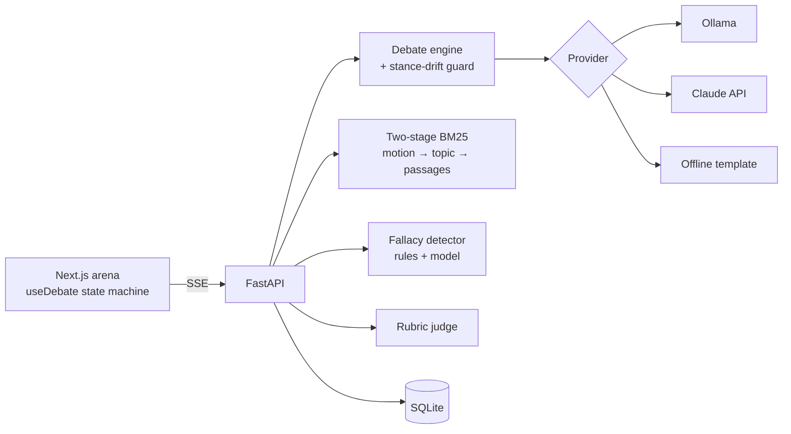

<p align="center">
  <picture>
    <source media="(prefers-color-scheme: dark)" srcset="docs/logo/logo-full-dark.svg">
    
  </picture>
</p>

# Debatrix

An AI debate sparring partner. Pick a motion and a side; Debatrix takes the **opposite** side, argues back with cited evidence, flags the logical fallacies in your arguments as you type them, and scores your case at the end.

It runs fully offline with a built-in template opponent, locally with **Ollama**, or with **Claude** via the Anthropic API.

## Features

- **A real opponent:** every reply streams in four parts (position, arguments, counter to *your* last point, and a question back) over Server-Sent Events.
- **Holds its stance:** a drift guard checks the position before anything is shown. If the model concedes or flips sides, the turn is regenerated with the same model, and only then falls back.
- **Evidence-backed:** two-stage retrieval over a bundled corpus of cited passages (OECD, NIST and others). The motion picks the topic, then BM25 ranks that topic's passages against your argument. Citations appear in an evidence desk with links.
- **Fallacy radar:** ten classic fallacies (ad hominem, straw man, slippery slope, false dilemma, appeal to authority, hasty generalisation, whataboutism, appeal to emotion, bandwagon, circular reasoning) are highlighted inline with explanations. Lexical rules always run; Claude/Ollama add model classification with schema-validated output.
- **Four personas:** Socratic, Aggressive Litigator, Academic, Devil's Advocate.
- **Transparent judge:** a five-criterion rubric (evidence use, logical validity, rebuttal quality, clarity, fallacy control) shown as a radar chart. Every score comes with the observable reason behind it.
- **Works with no model:** the offline opponent varies with your argument and draws on the retrieved evidence, so you can demo the full app with zero setup.

## Architecture



```
backend/debatrix/
  main.py           routes + SSE streaming
  debate_engine.py  section parsing, stance-drift guard, retry
  llm/providers.py  Mock / Ollama / Anthropic behind one interface
  rag.py            BM25, topic matching, retrieval
  fallacies.py      lexical rules + model merge with exact spans
  judge.py          rubric scoring
  storage.py        SQLite sessions
frontend/
  lib/useDebate.ts  phases: setup → starting → streaming → ready → judging
  lib/sse.ts        incremental SSE decoder (chunk-boundary safe)
  components/       SetupPanel, DebateArena, AiTurnCard, UserArgument,
                    JudgeScorecard (SVG radar), DebateSidebar, Composer
```

## Quickstart

Requires Python 3.10+ and Node.js 22+ (frontend tests use Node's built-in TypeScript support).

```bash
# API (offline: no model or key needed)
cd backend
python -m venv .venv && source .venv/bin/activate   # Windows: .venv\Scripts\activate
pip install -r requirements.txt
DEBATRIX_PROVIDER=mock uvicorn debatrix.main:app --reload   # PowerShell: $env:DEBATRIX_PROVIDER="mock"
```

```bash
# UI, in a second terminal
cd frontend
npm install
npm run dev
```

Open http://localhost:3000.

**With Ollama:** `ollama pull llama3.1`, then run the API with `DEBATRIX_PROVIDER=ollama` (the default). `OLLAMA_URL` and `OLLAMA_MODEL` are configurable.

**With Claude:** set `DEBATRIX_PROVIDER=anthropic` and `ANTHROPIC_API_KEY` (`ANTHROPIC_MODEL` defaults to `claude-opus-5-5`).

**Docker:** `docker compose up --build` (add `--profile ollama` to include an Ollama container). Copy `.env.example` to `.env` first.

If the selected provider is unreachable, the turn falls back to the offline opponent and the header shows a **FALLBACK** badge. Each debate stores its provider, and `POST /api/debates` accepts a per-session `provider` override.

## API

| Method | Path | Notes |
|---|---|---|
| GET | `/api/health` | Selected provider and whether it is reachable |
| GET | `/api/topics` | Starter motions |
| POST | `/api/debates` | `{ "topic", "side": "for" \| "against", "persona", "provider"? }` |
| POST | `/api/debates/{id}/turn` | `{ "argument" }` → SSE events `section`, `done`, `user` (fallacies), `citations`, `error` |
| POST | `/api/debates/{id}/judge` | Rubric scores, verdict, tips |
| GET | `/api/debates/{id}` | Persisted debate and turns |

Environment: `NEXT_PUBLIC_API_URL` (frontend), `DEBATRIX_DB` (SQLite path), `DEBATRIX_PROVIDER`, `OLLAMA_URL`, `OLLAMA_MODEL`, `ANTHROPIC_API_KEY`, `ANTHROPIC_MODEL`.

## Tests

```bash
cd backend && ruff check . && pytest        # 44 tests
cd frontend && npm test && npm run build    # SSE decoder tests + type-checked build
```

Covered: BM25 ranking and topic matching (including off-topic regressions), section parsing across every chunk boundary, each fallacy rule with exact spans, stance-drift true/false positives (including "therefore"/"bad *for* workers"), retry-before-fallback, provider fallback, every endpoint including SSE, judge bounds, and input validation. CI runs all of this on every push.

## Limitations

- The corpus is small (32 passages, eight topics). Custom motions outside it fall back to whole-corpus search, so evidence may be loosely related.
- Retrieval is lexical (BM25); there are no embeddings or freshness checks.
- Fallacy detection and drift detection are heuristics; they can misread context.
- Judge scores are coaching signals from observable features of your text, not an objective grade.
- Next.js 14 has open `npm audit` advisories whose fix requires a major upgrade.

MIT License.
